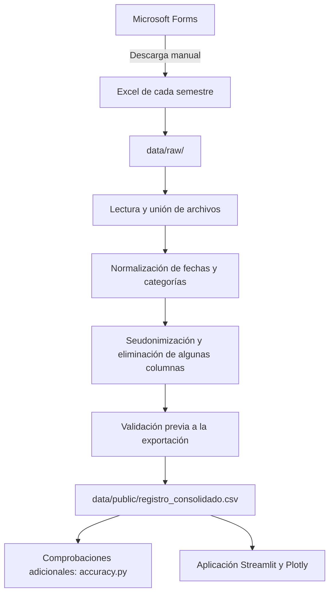

# Registro LEA

**Consolidación de registros de asistencia y análisis de uso del Laboratorio de Economía Aplicada (LEA)**  
Pontificia Universidad Javeriana Cali · Proyecto aplicado (2026)

## Descripción

El LEA registra la participación de estudiantes en monitorías y otras actividades mediante formularios de Microsoft Forms. Los archivos Excel exportados corresponden a diferentes semestres y presentan variaciones en los nombres de programas, cursos, actividades y personal responsable.

El proyecto **lee y une los Excel semestrales**, aplica reglas de limpieza y homologación, crea identificadores seudonimizados y genera un CSV consolidado que puede consultarse mediante una aplicación en Streamlit.

El objetivo es facilitar el análisis histórico de los servicios del laboratorio. **No reemplaza Microsoft Forms ni realiza el registro de asistencia en tiempo real.**

## Funcionalidades verificadas

| Componente | Función |
| --- | --- |
| Ingesta | Lee los archivos `.xlsx` de `data/raw/`, extrae el año a partir del nombre de cada archivo y concatena sus filas. |
| Limpieza | Normaliza encabezados, fechas y categorías de carrera, curso, actividad, semestre y personal responsable. |
| Identificadores | Genera IDs seudonimizados de estudiantes, profesores y monitores, y elimina determinadas columnas identificadoras antes de exportar. |
| Consolidación | Produce `data/public/registro_consolidado.csv` con registros de distintos periodos académicos. |
| Validación | Ejecuta comprobaciones de esquema, valores, coherencia temporal y ausencia de algunas columnas sensibles o cadenas con formato de correo. |
| Aplicación | Permite explorar indicadores y distribuciones de asistencia en Streamlit y Plotly. |

La descarga desde Microsoft Forms **es manual**. Una vez que se depositan los Excel en la carpeta local, Python ejecuta la transformación y consolidación. La publicación o actualización del tablero no forma parte de un flujo automatizado de extremo a extremo.

Los identificadores de estudiante son útiles para explorar usuarios distintos, pero **no demuestran una correspondencia perfecta entre una persona y un único identificador**: diferentes correos o variantes de nombre pueden fragmentar su historial.

## Flujo de datos



## Estructura del repositorio

```text
registro_LEA/
├── .streamlit/
│   └── config.toml
├── data/
│   ├── raw/                          # Excel de origen; excluido de Git
│   └── public/
│       └── registro_consolidado.csv  # Datos que consume la aplicación
├── src/
│   ├── ingestion/
│   │   └── load_data.py
│   ├── cleaning/
│   │   ├── anonymization.py
│   │   ├── clean_date.py
│   │   ├── clean_carrera.py
│   │   ├── clean_curso.py
│   │   ├── clean_semestre.py
│   │   ├── clean_actividades.py
│   │   └── clean_staff.py
│   ├── mappings/                     # Diccionarios de homologación
│   ├── pipeline/
│   │   ├── main.py                   # Orquestador
│   │   └── accuracy.py               # Comprobaciones del resultado
│   └── analysis/
│       └── app.py                    # Tablero
├── streamlit_app.py
├── requirements.txt
└── README.md
```

Algunos insumos no se versionan, entre ellos `data/raw/` y `src/mappings/staff.py`. **El procesamiento completo no puede reproducirse desde una copia recién clonada sin los archivos originales y las reglas locales necesarias**, cuya utilización debe estar autorizada.

## Tecnologías

- **Python y pandas:** lectura, limpieza, transformación y consolidación.
- **`hashlib` / SHA-256:** construcción de identificadores seudonimizados.
- **Streamlit y Plotly:** interfaz y gráficos interactivos.
- **Git y GitHub:** control de versiones del código.

## Ejecución local

### Requisitos

- Python 3.10 o superior.
- Archivos `.xlsx` por semestre en `data/raw/`. Sus nombres deben contener un año con cuatro dígitos (por ejemplo, 2025).
- Archivos locales de homologación requeridos por el código, cuando no estén publicados.
- Autorización para tratar los datos de origen.

### 1. Preparar el entorno

```bash
git clone https://github.com/sjestiven/registro_LEA.git
cd registro_LEA
python -m venv .venv
```

Activar el entorno virtual en Windows (PowerShell):

```powershell
.venv\Scripts\Activate.ps1
```

O en macOS/Linux:

```bash
source .venv/bin/activate
```

Instalar dependencias:

```bash
python -m pip install -r requirements.txt
```

### 2. Procesar los Excel

```bash
python src/pipeline/main.py
```

El programa lee los archivos, consolida los registros y genera o actualiza `data/public/registro_consolidado.csv`. También puede crear `logs.log` con información sobre la ejecución y valores que requieren revisión.

**Advertencia:** el destino actual es la carpeta `data/public/`. Antes de ejecutar el pipeline con datos reales se debe evaluar dónde almacenarlos y si pueden divulgarse; el nombre de la carpeta no implica autorización para publicarlos.

### 3. Verificar el CSV resultante

Para validar el archivo existente **sin ejecutar de nuevo el pipeline**:

```bash
python src/pipeline/accuracy.py --skip-pipeline
```

Para ejecutar el pipeline y después las comprobaciones:

```bash
python src/pipeline/accuracy.py
```

El script comprueba columnas requeridas, formato de identificadores, algunas señales visibles de información personal, completitud, consistencia de fechas y cruces básicos de variables. **No certifica anonimato, ausencia de reidentificación ni calidad integral del conjunto de datos.**

### 4. Abrir la aplicación

```bash
streamlit run streamlit_app.py
```

La aplicación suele abrirse en `http://localhost:8501` y lee el CSV consolidado; no se conecta a Microsoft Forms.

## Privacidad y publicación

El código elimina campos específicos de nombres y correos antes de escribir el CSV. Para generar el identificador de un estudiante selecciona, según disponibilidad, correo institucional, otro correo o nombre completo. Después calcula SHA-256 y utiliza **12 caracteres hexadecimales**; los identificadores de profesores y monitores también proceden de hashes truncados.

**Este mecanismo es seudonimización, no anonimización garantizada.**

- SHA-256 se utiliza sin una sal secreta, y los identificadores se truncan. Esto no elimina el riesgo de reidentificación ni asegura ausencia de colisiones.
- La combinación de periodo, carrera, curso, actividad y otros atributos puede conservar riesgo de identificación indirecta.
- La validación actual detecta ciertos nombres de columnas y patrones, pero no constituye una evaluación completa de privacidad.
- La publicación de código no autoriza por sí sola la distribución de registros institucionales o estudiantiles.

**Situación actual:** el repositorio público incluye `data/public/registro_consolidado.csv` con registros individuales seudonimizados. Antes de considerarlo un conjunto de datos de libre distribución o usarlo en un despliegue público, debe verificarse la autorización institucional y el riesgo de identificación indirecta. Para demostraciones abiertas, es preferible emplear datos sintéticos o un conjunto aprobado expresamente.

Cambiar este README **no retira los datos ya publicados**, ni del historial de Git ni de otros despliegues o copias.

## Limitaciones y trabajo futuro

- La extracción de Microsoft Forms no está conectada automáticamente mediante API.
- Las reglas de homologación dependen del formato esperado y de diccionarios que pueden requerir mantenimiento manual.
- La conciliación de identidades puede producir IDs diferentes para una misma persona.
- La aplicación depende de un CSV existente; no ejecuta el procesamiento al abrirse.
- Se requieren pruebas unitarias y un conjunto de datos sintéticos para demostrar reproducibilidad sin acceso a datos reales.
- Es necesario definir una estrategia autorizada de acceso, publicación y retención de información institucional.

## Participación y contexto

Proyecto aplicado al seguimiento de servicios del **Laboratorio de Economía Aplicada de la Pontificia Universidad Javeriana Cali**.

**Juan E. Silva** · Estudiante de Economía y monitor LEA. Participación en la definición de necesidades, revisión funcional y desarrollo de la herramienta con asistencia de IA en la implementación de Python.

- [GitHub](https://github.com/sjestiven)
- [LinkedIn](https://www.linkedin.com/in/sanchez-jestiven)
